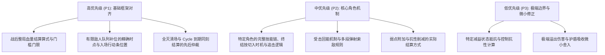

# 战斗模拟实机对齐数据需求指南

本指南列出将战斗模拟核心与真实游戏环境对齐时所需的样本、数据字段及证据采集规范。

当获取到实际对局录像或数据导出时，应参照本清单进行数据提取与场景复现。开发与核对时以单场完整对局为最小单元逐步对齐，无需等待全量角色或数据齐全后再开始。

---

## 1. 最小有效样本包 (First Useful Package)

一份能够用于对齐单场战斗的最小有效样本包应包含以下信息：

1. **环境与版本标识**：游戏客户端版本号、资源版本、对局日期、玩法赛季、节点类型（如战斗节点/首领节点）与当前难度层级。
2. **战前完整准备信息**：
   - 参战角色的星级、等级、星魂数、行迹解锁情况及实装光锥/遗器配置；
   - 角色在开战前的面板详情界面（生命、攻击、防御、速度、暴击、各属性增伤等）；
   - 局外携带的投资策略、祝福、环境 Buff 及初始资源（如初始战技点、秘技效果）。
3. **全程连续对局录像**：
   - 从进入战斗、开战特效、各波次交替，直至战斗胜利/失败界面的不间断视频；
   - 标明操作模式（全自动、手动干预或半自动）及战斗倍速设置。
4. **终局与结算界面**：
   - 战斗胜利/失败画面、显示的击败进度或通关评价；
   - 剩余轮次（Cycle）或剩余行动值（AV）；
   - 战前与战后的整局生命值（Run HP）变化，包括扣血与恢复的独立跳字提示。

---

## 2. 详细数据要素清单

在将录像或数据还原为模拟器场景配置（`Scenario`）时，按以下维度核对并保留对应时点的数值：

| 维度 | 关键提取字段 | 作用与技术影响 |
| --- | --- | --- |
| **对局标识** | 客户端/资源版本、赛季、关卡 ID、难度词条、超频等级 | 确保规则版本一致，避免新旧赛季机制混淆。 |
| **时钟与预算** | 初始轮次（Cycle）总数、首轮与后续各轮的独立 AV 额度、复活罚时扣减量 | 决定场景 `max_av` 与 `mechanics.cycles` 列表的设定。 |
| **队伍面板** | 基础属性、实时最终面板、遗器套装效果生效件数、光锥叠影 | 提供静态面板基准，区分开战常驻面板与战斗中动态 Buff。 |
| **初始状态** | 初始共享战技点、各角色初始能量、开局护盾、行动条初始位置 | 准确初始化 `State` 与 `CombatUnit`，避免默认零状态偏差。 |
| **有限敌人队列** | 场上最大敌人槽位数（容量）、后备敌人总数与出现顺序、补位时机与入场行动距离 | 用于配置 `mechanics.queue_capacity` 与第一波敌人序列。 |
| **行动与伤害事件** | 每次行动的施法者、主目标、受击段数、暴击判定、破韧数值、附加状态、连击与追击时序 | 对照技能链效果树（`Effect`），验证即时监听与追加动作顺序。 |
| **整局血量结算** | 敌人击杀权重、通关进度门槛比率、失败罚血量、战后恢复量、血量上限规则 | 用于配置 `mechanics.settlement`，准确计算战后整局存活与扣血。 |

---

## 3. 证据核对与规则对齐优先级

根据对模拟精度的影响程度，优先收集并核对以下规则证据：

1. **高优先级 (P1)**：
   - 战后整局血量结算算法（进度比率分母是否包含召唤物、罚血与回血执行顺序）；
   - 有限队列补位规则（确认是否在完整 Action 彻底结束后补入，以及新入场单位的初始行动条距离）；
   - 倒计时终局判定（确认 AV 耗尽时已进入回合的收尾细节）。
2. **中优先级 (P2)**：
   - 目标角色专属机制（如追加攻击层数累计、终结技插队结算、被动技能触发点）；
   - 敌方技能循环与索敌偏好（常规行动与蓄力机制）。
3. **低优先级 (P3)**：
   - 罕见异常状态交互、复杂动画后摇导致的显示差异（模拟器仅对齐逻辑时序与数值）。
