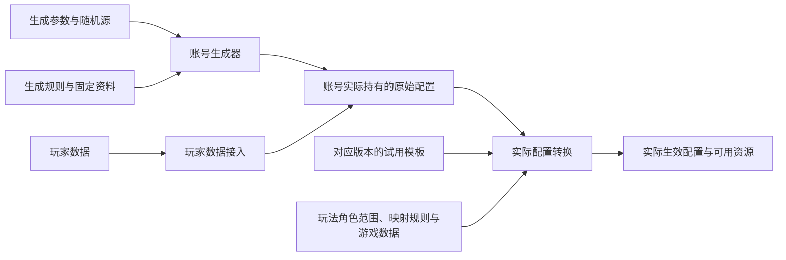

# 账号数据流与模块职责

账号生成与 reliquary-archiver v4 导入都交付 `RawAccount`，两类输入已接通实际配置转换。局面模拟、模型输入编码与战斗侧的规划见[系统设计](../../project/architecture.md)。

## 处理流程

程序生成与玩家数据接入提供账号实际持有的角色、光锥、遗器和装备关系。后续配置转换按角色 ID 为未持有角色补齐试用，再应用游戏规则，输出实际生效配置及可用资源，供局面模拟和模型输入编码使用。

## 调用实际配置转换

将 `GeneratedAccount.account` 或导入得到的 `RawAccount`、转换资料 `PlayableData` 和转换请求 `ConversionRequest` 传给 `convert_playable_account`。账号的游戏版本须与转换资料一致。转换资料须包含参与转换的角色、装备数据，以及原始角色 ID 和能力版本对应的行迹绑定。例如，外部 4.7 快照为流萤（`1310`）指定了转换资料缺少的能力版本时，转换返回 `ConversionError`。见[转换输入与错误条件](../account/playable-configuration.md#输入与交付)。

原始账号用角色条目是否存在表达持有情况。缺席角色在实际配置阶段采用试用模板；生成器返回的每个角色都是持有条目。原始字段见[Rust 账号模型](../account/README.md)。

生成行迹时按角色的原始等级、突破阶段与前置条件选择可用基础等级。配置转换再执行游戏内强制映射，包括等级 80 和对应行迹等级保底；触发条件、默认配置和替换范围在[游戏规则](../../project/game-rules.md)中维护。

账号转换提供统一静态配置。模型编码结合可见局面与挑战条件；战斗输入组装结合实际局面、敌人和游戏资料，计算伤害补正等固定系数。战斗引擎接收明确参数，实时计算 buff、技能触发、行动与伤害结算，局面模拟再处理整局收益和生命结算。

## 资源与版本怎样传递

账号原始配置保存持有资源及装备引用。实际配置转换根据实际持有情况选择本体或试用，供后续选择资源和检查操作使用。用于全试用挑战的账号按其真实持有资源独立导入和转换。

复现生成的原始账号见[复现生成结果](account-generation.md#复现生成结果)。重放配置转换时，保存原始账号、项目的 Git 提交、实际使用的转换资料（文件或唯一快照 ID）和完整的 `ConversionRequest`。其中 `config_id` 指定输出配置 ID，`character_aliases` 保存已确认的原始角色 ID 到目标角色 ID 的对照。例如导入的开拓者使用 `8010 → 8009` 对照时，重放也要传入这组对照，才能按同一本体转换。生成账号的 `data_snapshot` 取自生成资料清单，可以为空。生效配置记录转换资料的快照 ID。
