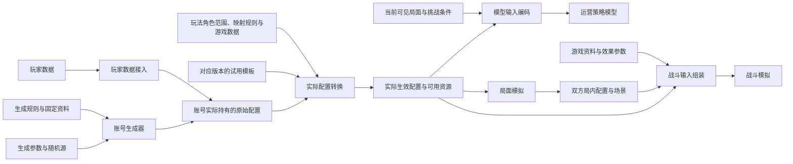

# 账号数据流与模块职责

Rust 账号生成器和 reliquary-archiver v4 导入均已接入统一的原始账号类型，可直接执行实际配置转换。本文用于对接账号生成、模型输入和战斗模拟。

## 处理流程

程序生成与玩家数据接入提供账号实际持有的角色、光锥、遗器和装备关系。后续配置转换按角色 ID 为未持有角色补齐试用，再应用游戏规则，输出实际生效配置及可用资源，供局面模拟和模型输入编码使用。

## 各模块交付什么

| 模块 | 接收 | 交付 |
| --- | --- | --- |
| 账号生成器 | 持有人数、金数或统一五星配装、遗器指标、投入分布和随机源 | 持有角色、光锥、遗器及装备关系，附实际资源指标 |
| 玩家数据接入 | 玩家提供的数据 | 字段和单位统一后的持有资源与原始配置 |
| 配置转换 | 原始配置、试用模板、玩法角色范围及对应版本的游戏规则 | 按持有情况补齐角色后，实际生效的等级、行迹、属性、机制引用和可用资源 |
| 局面模拟 | 账号可用资源、当前局面、操作及节点规则 | 更新后的整局状态与实际出战配置 |
| 模型输入编码 | 生效配置、可见局面及挑战条件 | 模型使用的结构化输入 |
| 战斗输入组装 | 账号静态配置、实际局面和游戏资料 | 双方开战属性、固定系数、动作与效果参数 |
| 战斗引擎 | 已组装的战斗输入 | 战斗过程、实时 buff 与效果结算、战斗结果 |

账号生成器位于 `research/account_generation/`，供研究和训练调用。玩家数据接入位于 `core/account/`，当前支持 [reliquary-archiver v4 导入](../account/reliquary-import.md)。运行方式见[账号数据生成](account-generation.md)、[完整角色配置生成](character-generation.md)与[单件遗器生成与评分](relic-generation.md)。

程序生成和玩家导入共用 `core/account/` 的 [Rust 账号模型](../account/README.md)。将生成结果 `GeneratedAccount.account`、版本匹配的 `PlayableData` 和指定输出配置 ID 的 `ConversionRequest` 一起传给 [`convert_playable_account`](../account/playable-configuration.md)，即可完成试用补齐、练度与装备映射、技能加级和静态面板计算。原始账号保存持有库存及装备引用。生成统计保存在 `GeneratedAccount`，导入报告保存在导入结果。

## 生成与实际配置的分工

| 阶段 | 处理内容 |
| --- | --- |
| 原始数据生成 | 选择持有角色与装备，光锥留空时按同命途推荐选择、显式指定时直接采用，生成原始等级、星魂、行迹基础等级、叠影和遗器数值，建立装备引用 |
| 实际配置转换 | 按持有列表补齐试用，应用练度保底、星魂技能加级和无条件静态属性 |
| 局面模拟 | 推进节点和运营操作，维护形态、星级、站位、商店等级、装备、投资和羁绊 |
| 战斗输入组装 | 按实际局面查资料，计算开战属性及固定乘区，组装双方动作和效果 |

原始账号用角色条目是否存在表达持有情况。缺席角色在实际配置阶段采用试用模板；生成器返回的每个角色都是持有条目。原始字段见[数据设计](design.md#原始配置保存什么)。

生成行迹时按角色的原始等级、突破阶段与前置条件选择可用基础等级。配置转换再执行游戏内强制映射，包括等级 80 和对应行迹等级保底；触发条件、默认配置和替换范围在[游戏规则](../../project/game-rules.md)中维护。

账号转换提供统一静态配置。模型编码结合可见局面与挑战条件；战斗输入组装结合实际局面、敌人和游戏资料，计算伤害补正等固定系数。战斗引擎接收明确参数，实时计算 buff、技能触发、行动与伤害结算，局面模拟再处理整局收益和生命结算。

## 资源与版本怎样传递

账号原始配置保存持有资源及装备引用。实际配置转换根据实际持有情况选择本体或试用，供后续选择资源和检查操作使用。用于全试用挑战的账号按其真实持有资源独立导入和转换。

调用方在实验记录中保存项目的 Git 提交、账号生成请求和随机种子。原始配置与生效配置通过配置 ID 关联。原始配置的 `data_snapshot` 取自生成资料清单，可为空；生效配置记录转换资料的快照 ID。复现时分别保存两份资料的标识或文件。两个下游使用同一次转换结果，便于复现模型决策和战斗计算。

完整账号样例的交付条件见[首个样例与完成条件](design.md#首个样例与完成条件)。
