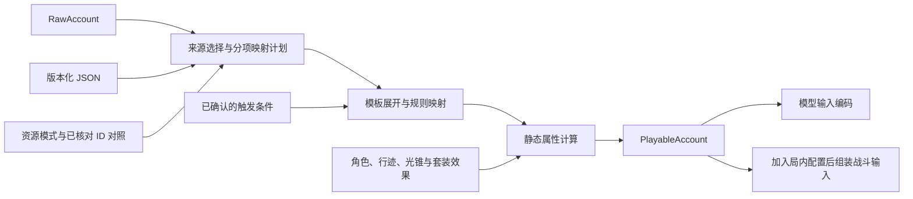

# 实际游玩配置、试用补齐与映射

状态：Rust 数据结构、文档数值 JSON、角色来源选择及遗器等级触发判断已实现；本页定义后续模板展开和静态面板计算的算法。适用游戏版本为 4.7，玩法为货币战争 S2。

## 输入与交付

转换接收 `RawAccount`、对应版本的数据快照、资源模式及映射选择，输出 `PlayableAccount`。后续模型编码和战斗组装共用这份结果。角色与光锥统一为 80 级、进阶 6，由 Rust 共用常量定义。

流程分两步：`ConfigurationPlan` 先确定每个角色采用本体还是试用，并保存分项映射选择；展开阶段生成行迹、装备和面板。条件或资料缺失时，计划保留待判断项，展开阶段报告具体缺项。



## Rust 数据结构

类型放在 `core/account/`，继续使用根 Cargo workspace。原始账号类型放在 `src/raw/`，数据载入放在 `src/reference/`，来源选择和最终配置分别放在 `src/playable/planning.rs` 与 `src/playable/mod.rs`。

| 类型 | 保存内容 |
| --- | --- |
| `PlayableAccount` | 格式版本、配置 ID、原始配置 ID、游戏版本、赛季、快照、转换规则版本、资源模式、角色列表及持有装备库存 |
| `PlayableCharacter` | 角色 ID、来源、星魂、能力版本、行迹、光锥、遗器和静态面板 |
| `CharacterOrigin` | 本体及原始角色 ID、试用模板，或玩法专属模板 |
| `PlayableTraces` | 节点解锁状态与计入星魂加级后的技能等级 |
| `PlayableLightCone` | 光锥种类、叠影及库存实例或模板来源 |
| `PlayableRelics` | 本体按内外圈保存，或直接采用试用的六件属性合计 |
| `PlayableRelicGroup` | 一圈采用的原始实例 ID，或整圈映射的套装与属性合计 |
| `CharacterPanel` | 生命、攻击、防御、速度、嘲讽、暴击、命中、抵抗、击破、回能、治疗、各属性增伤、欢愉度及能量容量 |

`PLAYABLE_ACCOUNT_SCHEMA_VERSION` 当前为 1。固定值保留小数，百分比保存比例值，例如 `0.08` 表示 8%。属性键沿用原始遗器及 Python 生成器约定。面板的能量恢复效率以 `1.0` 为基础值；遗器提供的回能属性表示增加量。

原始库存保持实际持有的装备实例。试用和映射装备随角色配置保存，通过来源引用约束用途。全试用模式保留账号库存信息，资源选择按模式排除本体装备。角色形态之间的共用资源关系由组装入口检查。

局内星级、前后台、投资、羁绊和当前生命等在后续流程加入。`gameplay-forms.json` 提供对应资料，账号转换保留常规角色 ID；战斗组装再选择玩法 ID 与局内星级。

## 文档数据文件

文件位于 `core/account/data/s2-v4.7/`，由 `PlayableData::bundled()` 载入。数值口径见[角色基础数据](../../game-data/character-data.md)、[光锥基础数据](../../game-data/light-cone-data.md)、[试用与映射配置](../../game-data/character-trial-mapping.md)及[玩法角色数据](../../game-data/currency-wars-character-data.md)。

| 文件 | 条目 | 内容 |
| --- | --- | --- |
| `characters.json` | 61 | 60 个常规角色及帕姆大王的基础属性、命途、属性、能量容量 |
| `light-cones.json` | 172 | 光锥 ID、命途、品质及 80 级、突破 6 的基础属性 |
| `trial-templates.json` | 61 | 试用星魂、技能基础等级、未激活小行迹、光锥、套装及六件属性合计 |
| `mapping-templates.json` | 60 | 常规角色的外圈与内圈映射配置 |
| `default-light-cones.json` | 9 个命途 | 各命途的默认映射光锥 ID |
| `gameplay-forms.json` | 63 个形态 | 每个形态保存费用、站位及各星级参数，共 216 组星级数值 |
| `minor-traces.json` | 600 个节点 | 60 个角色的 201～210 小行迹节点及属性加成，见[小行迹表](../../game-data/currency-wars-minor-traces.md) |
| `manifest.json` | 1 份 | 程序使用的游戏版本、赛季和快照 ID |

数据文件直接保存数组或规则对象，Rust 按对应类型读取。游戏版本、赛季和快照 ID 在 `manifest.json` 中统一维护，供版本核对和结果关联使用。

试用表给出六件总属性，`TrialRelics` 直接保存该总量。映射表分别给出四件外圈和两件内圈总属性，`RelicGroupTemplate` 按圈保存。两者都包含主副词条，套装效果另外计算。试用瓦尔特的虚数增伤为 `0.3888`，映射内圈为 `0.388803`，各自保留原表精度。

可选数值缺项通过缺少字段表示。玩法数值按形态分组，各星级共用角色 ID、费用和站位。星神★阿哈的三个玩法 ID 关联同一常规角色和模板；帕姆大王保留玩法专属来源。固定等级、进阶、模板光锥叠影及基础幸运值使用 Rust 共用规则。基础暴击率仅保存角色的特殊取值。

## 试用补齐算法

当前公开入口为 `plan_playable_account(raw, data, request)`，返回 `ConfigurationPlan`。

1. 检查原始账号格式版本；账号已标明游戏版本时，与目标资料版本核对。
2. 建立原始角色 ID 索引，拒绝重复 ID。调用方可传入已核对的直接 ID 对照；多个持有条目对应同一目标时报告冲突。
3. 按试用表顺序遍历全部玩法角色。普通模式中，持有的角色采用本体，缺席的角色采用试用；全试用模式采用试用表。玩法专属角色采用专属模板。
4. 对本体分别记录星魂、行迹、光锥、外圈、内圈的选择。遗器按等级自动判断；其他未提供结论的部分保存为 `Undetermined`。手动选择与已确定的遗器规则冲突时报告错误。
5. 返回来源计划，并列出资料范围之外的原始角色 ID。原始账号保持原值。

ID 对照由明确的形态关系提供。例如文档开拓者使用 `8009`，导入可能出现 `8010`；调用方确认两者适用同一模板后，传入 `8010 → 8009`。来源计划保留原始 ID。其他命途或形态继续按各自 ID 处理。

## 映射算法设计

映射分为判断与应用。各部分对原始配置求值，得到 `KeepOwned`、`UseTemplate` 或 `Undetermined`。同一次判断统一读取原始配置。

| 部分 | 判断所需输入 | `UseTemplate` 的应用结果 |
| --- | --- | --- |
| 星魂 | 角色稀有度 | 四星为 6，五星为 0，由 `mapped_eidolons` 计算 |
| 行迹 | 同一角色和能力版本的本体、试用基础行迹 | 逐项补到试用下限，保留本体更高等级和已激活节点 |
| 光锥 | 空装状态、原光锥命途、品质、等级、突破、叠影及触发条件 | 按角色命途选择默认映射光锥，叠影为 1 |
| 外圈遗器 | 外圈任意一件低于 +15 | 外圈四件的套装与主副词条整圈采用模板 |
| 内圈遗器 | 内圈任意一件低于 +15 | 内圈两件的套装与主副词条整圈采用模板 |

遗器等级判断已实现：一圈任意一件低于 +15 时选择 `UseTemplate`，该圈全部达到 +15 时选择 `KeepOwned`。例如外圈头部为 +12，其余三件为 +15，外圈完整采用映射套装和属性；内圈独立判断。空部位尚未定义具体替换规则，若其余已装备遗器均满级，保留待判断。装备引用缺失或部位不一致时报告错误。

内外圈映射读取独立模板，星魂映射目标由稀有度计算，行迹保底直接读取试用行迹。

行迹保底由 `playable::traces::raise_traces_to_trial` 执行，接收已绑定真实节点 ID 的本体和试用行迹。基础技能等级逐项取 `max(本体等级, 试用等级)`，随后再计算星魂加级。试用已激活的一次性节点补齐，本体已激活的节点保留。模板通过 `inactive_minor_nodes` 引用小行迹 ID，属性从小行迹表读取；具体游戏内补齐行为仍需验证。

后续展开按以下顺序执行：

1. 解析角色能力版本。有强化形态时使用该版本对应的技能、行迹和星魂资料；具体版本 ID 从资料查询。
2. 对本体求出分项映射选择。所有必需选择确定后，在新的配置中应用替换；试用角色直接展开试用模板。
3. 按最终能力版本绑定真实行迹节点和技能 ID。按试用配置补齐基础行迹，再按最终星魂加级一次。小行迹表使用 201～210 节点 ID，结合角色 ID 和能力版本绑定完整节点；每个试用模板明确列出未激活节点。
4. 展开光锥和遗器来源。原装遗器通过实例读取实际主副词条；模板遗器读取合计属性。外圈和内圈分别替换，套装 ID 与该圈属性一起更新。
5. 汇总角色、光锥、行迹、星魂和遗器的静态属性，并处理无条件的套装属性。依赖敌人、动作、生命比例或队伍条件的效果在战斗阶段通过配置中的 ID 查询。
6. 计算静态面板。例如生命按“角色与光锥基础生命之和 ×（1 + 百分比加成）+ 固定加成”计算；速度及其他转换效果按各自已确认公式处理。
7. 检查装备实例存在、部位一致、资源复用限制和模板使用范围。需要嘲讽等缺失属性的下游入口报告所需数据。确认必需数据齐全后，输出 `PlayableAccount`。

示例：瓦尔特采用本体、外圈选择 `UseTemplate`、内圈选择 `KeepOwned` 时，外圈使用映射套装 `117` 及其整圈属性，内圈仍读取账号原有实例。试用瓦尔特直接采用试用套装 `112`／`303` 及六件合计。属性汇总对每份遗器来源计入一次。

## 展开所需资料

模板展开需要光锥替换条件、技能节点绑定、角色 ID 对照和静态效果。原始遗器主词条的数值读取在面板计算阶段接入共用规则。帕姆大王的行迹在原表为 `—`，由专属机制资料确定展开方式。

## 运行与验证

在仓库根目录运行：

```powershell
cargo run --locked -p account-core --example plan_playable -- <原始账号.json> <计划输出.json>
cargo test --locked -p account-core
cargo fmt --all -- --check
cargo clippy --locked -p account-core --all-targets -- -D warnings
```

示例输出角色来源和分项映射计划。输出目录需预先存在。测试覆盖角色与光锥引用、试用和映射数值差异、玩法专属角色、显式 ID 对照、重复冲突、全试用模式及内外圈独立选择。
