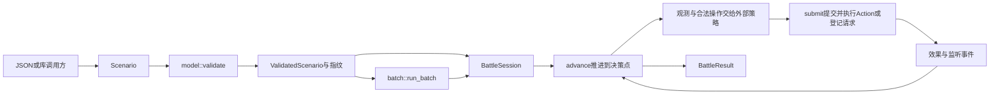

# 战斗模块的逻辑与类型设计

本文对应 `core/battle` 的实际实现。目录参考 `main` 的 `core/account`，按处理对象和执行职责拆分。两个 crate 共用根 workspace 和依赖，战斗核心接收调用方已经组装好的有效面板。账号转换的接口和规则见 [account 模块](../account/README.md)。

## 从哪里开始读

```text
core/battle/
├── src/
│   ├── lib.rs                库的公开入口
│   ├── main.rs               JSON 文件与命令行参数
│   ├── model/
│   │   ├── mod.rs            输入、校验与结果的公开入口
│   │   ├── unit.rs           面板、单位、初始资源
│   │   ├── action.rs         动作、效果与条件
│   │   ├── scenario.rs       场景、规则参数、校验后输入
│   │   ├── events.rs         事件、监听器、插入请求
│   │   ├── result.rs         单局、单位、队列和回放输出
│   │   └── validation/       场景、单位、效果、机制的校验
│   ├── engine/
│   │   ├── mod.rs            同步调用入口，驱动同一分步会话
│   │   ├── session.rs        可暂停推进、决策提交和结束阶段
│   │   ├── state.rs          本场状态、单位入场、队列补位
│   │   ├── operations.rs     合法操作、策略选择、资源支付
│   │   ├── targets.rs        目标选择
│   │   ├── effects.rs        顺序执行效果树
│   │   ├── damage.rs         逐命中伤害、护盾、HP和事件
│   │   ├── values.rs         表达式绑定与条件求值
│   │   ├── events.rs         到期处理、监听分派、死亡与复活
│   │   ├── timeline.rs       行动距离、时钟、Cycle额度
│   │   ├── rng.rs            三条随机流的固定派生
│   │   └── result.rs         导出结果、计算声明的HP结算
│   ├── mechanics/
│   │   ├── math.rs           伤害、治疗和护盾公式
│   │   ├── expression.rs     动态算术表达式
│   │   ├── dynamic_scope.rs  Ability和TaskTemplate临时变量
│   │   ├── modifiers.rs      属性状态的叠层、刷新和到期
│   │   ├── elements.rs       元素选择、七元素增伤与抗性
│   │   └── weakness.rs       自然弱点与状态附加弱点的合成
│   ├── decision.rs           策略接口、观测、合法操作类型
│   ├── batch.rs              独立试验、统计、种子明细
│   └── settlement.rs         显式配置的本场临时整局HP结算
├── tools/
│   ├── raw_config/           来源配置的校验和片段编译
│   ├── scenarios/anaxa.py    公开的Anaxa S2近似场景生成器
│   └── tests/               Python工具测试
├── tests/                    Rust集成测试和手算用例
└── examples/                 可直接运行的JSON输入
```

推荐依次阅读 `model/scenario.rs`、`model/action.rs`、`engine/mod.rs`、`engine/operations.rs`、`engine/effects.rs`，再按需要查公式和状态机制。`mod.rs` 聚合本职责的实现。较小且职责完整的 `decision.rs`、`batch.rs` 和 `settlement.rs` 保持单文件。

`battle_core::model`、`battle_core::engine` 等现有调用路径继续可用。原来的 `math`、`expression`、`modifiers` 等公开模块由 `lib.rs` 重导出，实际实现集中在 `mechanics/`。

## 一次战斗如何执行



1. **读取和校验。** CLI 读取 JSON，库调用方也可直接构造 `Scenario`。`validate` 检查版本、数值范围、全局唯一单位 ID、动作资源、嵌套效果、监听器和机制引用，再序列化输入计算 SHA-256 指纹。双方条件分支都参与结构校验。
2. **建立本场状态。** `State` 借用已校验输入，为双方建立独立的 `CombatUnit`。首次入场、换波、队列补位使用同一个构造函数，加载初始 HP、能量、韧性、动态变量和复活次数。随后分派 `BattleStart` 和 `WaveStart`。
3. **检查公共边界。** 主循环先判断双方是否被消灭、是否切换波次。AV归零后完成已进入的单位Turn，再处理到期的Cycle；最终Cycle结束触发额度耗尽结算。清场/全灭也可独立结束。取消和行动上限返回未完成结果。
4. **处理插入。** 有限队列先补空位；策略可提交当前合法终结技。排队的终结技入 Turn 时重新检查资源并先付能量，再触发 `TurnStart`；额外回合在 `TurnStart` 后选招；追击直接执行 Action。
5. **推进普通行动。** 没有待处理插入时，完成上一个普通 Turn 的 `TurnEnd`，重置其行动距离并应用下次行动提前。下一单位的等待时间是“剩余距离 ÷ 当前速度”。推进时间时扣减所有存活单位的距离；速度变化保留当前距离。
6. **选择和执行动作。** 会话生成包含观测和合法`Operation`的`Decision`并暂停。调用方选招后携带决策ID调用`submit`，引擎检查ID与合法性，再绑定目标、支付资源、执行有序效果和收益，分派`ActionEnd`。同步`Policy`入口也通过该流程驱动会话。
7. **执行命中和监听。** 每次命中读取当前属性状态，选择元素和暴击，计算伤害，先吸收护盾再扣 HP，接着分派命中和死亡事件。即时监听效果可以改变后续命中的状态；登记的后续 Action 在当前 Action 完成后执行。
8. **导出结果。** 输出单位快照、事件、停止原因、AV余额和输入身份。输入声明了结算策略时，计算本场进度和临时整局 HP 变化。批次调用为每场派生独立种子，再汇总同一引擎的结果。

事件分派先处理所有适用状态的到期，再运行监听器。全局事件作用于已经入场的单位；未来波次的单位从入场后开始计时。回放开关和事件条数上限影响记录，运行中的监听器仍按相同顺序执行。

## 为什么定义这些输入类型

结构体把一组需要一起传递的数据放在一起；枚举表达有限的合法选择，携带该选择需要的参数。这里的 `Effect`、`Expression` 和 `Condition` 都由枚举构成树，可以直接序列化、递归校验和执行。

| 类型 | 保存什么、为什么需要 |
| --- | --- |
| `Stats` | 调用方合成后的有效属性。伤害、治疗和护盾复用同一面板口径。 |
| `Unit` | 单位 ID、面板、初始 HP/能量、动作列表和复活配置。它给出本场创建单位的完整输入。 |
| `Revival` | 复活次数、恢复比例和罚时。把可选复活规则放在一起，方便按单位声明。 |
| `SkillPoints` | 一方的初始战技点和上限。资源属于队伍，多个单位共享。 |
| `Action` | 技能标识、类别、资源消耗/收益和有序效果。费用、效果和收益具有明确执行顺序。 |
| `Scale` | 用攻击、防御或生命上限计算基础量。伤害、治疗和护盾共用这些基数。 |
| `Target` | 自身、队友、单体敌人、全体、随机或已绑定目标等选择规则。引擎统一处理存活性和选择时机。 |
| `ActionKind` | 普攻、战技、终结技、追击。用于合法操作和动作级条件。 |
| `AttackType` | 普通命中和追加命中。一次战技内可包含追加伤害，监听器需要取得该次命中的类别。 |
| `Effect` | 伤害、治疗、护盾、资源、行动提前、状态、分支、循环和请求等具体指令。每个分支携带必需参数，执行顺序由列表确定。 |
| `Comparison` | 六种数值比较运算。JSON和运行时共用明确的运算名称。 |
| `Condition` | 数值比较、状态存在、动作/命中类型及逻辑组合。用于运行时选择效果分支。 |
| `Provenance` | 游戏版本、数据快照和场景说明。结果可以追溯输入来源。 |
| `Scenario` | 双方单位、波次、共享资源、预算、来源和机制参数。它是一场可复现战斗的输入。 |
| `Mechanics` | Cycle额度、监听器、动态初值、属性状态、元素面板、队列和结算等显式参数。它集中维护本场选用的规则配置。 |
| `ValidatedScenario` | 已检查的场景与指纹，通过只读访问器交给引擎。批次重复运行时共用同一份输入。 |
| `BattleEvent` | 战斗、波次、Turn、Action、命中、击破、死亡和Cycle等监听点。到期计时和触发器按这些点执行。 |
| `Trigger` | 监听者、事件、对象/动作过滤、次数、寿命和效果。描述何时执行一段效果。 |
| `RequestKind` | 终结技、额外回合、追击。三者的付费和Turn边界不同，需要明确区分。 |

`Outcome` 与 `Termination` 分开：前者表达胜利、失败、平局或未完成，后者说明清场、团灭、预算耗尽、行动保护或取消等具体原因。批次统计据此选择有效样本。

## 运行状态与策略为什么分开

| 类型 | 保存什么、为什么需要 |
| --- | --- |
| `CombatUnit` | 本场面板副本、当前 HP/护盾/能量、剩余距离、韧性、状态和变量。速度和击破标记在本场副本中更新；初始输入可用于下一次试验。 |
| `State` | 所有本场单位、队列、共享战技点、时钟、监听器、随机流、目标上下文和回放。引擎通过它执行状态变化。 |
| `BattleSession` | 保存一场战斗的状态、种子、决策序号和推进阶段。外部模型可以在`advance`与`submit`之间等待或记录训练样本。 |
| `BattleStep` | 向调用方返回等待中的决策或完成结果，两种返回状态明确区分。 |
| `Phase` | 会话内部的公共边界、插入选择后、等待决策、已完成或失败阶段。暂停后从对应阶段继续，避免重复付费和重复事件。 |
| `Timeline` | 当前AV、Cycle索引、剩余额度、各轮额度和累计罚时。复活罚时扣减当前额度，时钟和单位距离保留。 |
| `Pending` | 待执行单位、插入类别和可选动作索引。请求排队后，在实际执行入口检查资源。 |
| `Hook` | 一条 `Trigger` 的本场剩余次数和寿命。多次模拟分别计数。 |
| `Operation` | 合法操作中的单位索引和动作索引。策略返回列表中的一个选项即可。 |
| `DecisionPoint` | 插入窗口、普通Turn、额外Turn。不同窗口提供不同的合法操作。 |
| `Decision` | 单场递增ID、决策类别、当前观测和合法操作列表。提交时核对ID，拒绝过期或重复选择。 |
| `AxisPosition` | 单位当前距离、速度和等待AV。为策略提供排序后的行动轴。 |
| `Observation` | 当前时钟、Cycle、本轮及总剩余AV、双方战技点、行动轴和已入场单位快照。策略通过不可变借用读取当前战况。 |
| `Policy` | 从合法操作中选择的 trait。自动策略和闭包使用同一入口，方便替换决策逻辑。 |
| `Automatic` | 默认选择合法列表第一项的无字段结构体。用最小策略让引擎和样例直接运行。 |

`CombatUnit::snapshot` 同时生成观测和最终结果里的 `UnitResult`，字段含义保持一致。当前 `Observation` 包含模拟器已有的单位信息；玩家端或训练端接入时，观测裁剪仍需按可见信息约定实现。

`State` 保存的目标上下文各有时机：`bound_target` 在Action入口绑定；`context_target` 服务于临时重选目标并在返回后恢复；`attack_targets` 记录当前动作实际命中过的单位，供选定的追加攻击逻辑使用。嵌套监听的元素和命中类别也在返回后恢复。

## 表达式、属性状态与元素

| 类型 | 保存什么、为什么需要 |
| --- | --- |
| `Expression` | 常量、持久变量、临时变量和算术树。反映计数器和实时状态变化，缺失绑定由求值入口报错。 |
| `DynamicScope` | Ability与TaskTemplate两种调用范围。相同变量名可以属于不同调用。 |
| `Frame` | 一次临时调用的所属单位、范围和变量表。离开调用时整体移除。 |
| `ScopeFrames` | 临时调用帧栈。读取匹配的最内层调用，同名内层帧遮蔽外层帧。 |
| `Property` | 当前支持的暴击伤害和伤害提高。限制状态可贡献的属性集合。 |
| `PropertyChange` | 一项属性与其数值表达式。应用或刷新叠层时求值并保存快照。 |
| `StackMode` | 按来源替换、按来源累加、全局替换。状态叠层遵循输入声明的方式。 |
| `TickUnit` | 按持有者或来源单位的事件计时。区分两种寿命所属对象。 |
| `Lifetime` | 到期事件、计时对象和次数。状态机制据此统一扣减剩余寿命。 |
| `ModifierDefinition` | 叠层方式、上限、寿命和属性贡献的输入定义。多次施加可共用同一条规则。 |
| `ModifierState` | 对外报告的状态 ID、来源、层数和余寿命。观测和结果可以检查当前状态。 |
| `ModifierInstance` | 一次活动状态的规则、层数和已求值属性。刷新时保存当时数值。 |
| `ModifierBook` | 单位拥有的活动状态集合。统一处理施加、移除、到期和属性求和。 |
| `Element` | 七种元素。增伤、抗性、随机元素和弱点使用同一组标识。 |
| `DamageElement` | 固定元素或七元素均匀随机。描述命中的元素选择方式。 |
| `ElementProfile` | 完整七元素增伤和抗性。按本次元素取得数值。 |
| `WeaknessState` | 自然、附加和合并后的弱点集合。输出时从自然输入与当前活动状态重新合成。 |
| `DamageInput` | 进入公式的一次命中所需乘区参数。可单独验证伤害公式。 |
| `DamageBreakdown` | 基础量、每个乘区、暴击结果与总伤害。公式测试可以定位某个乘区的差异。 |

持久变量保存在单位的 `dynamic_values`；临时变量保存在调用帧。两者显式寻址。伤害公式只计算数值，命中对象、随机采样、护盾吸收和HP扣减由引擎处理。

## 结果、统计和HP结算

| 类型 | 保存什么、为什么需要 |
| --- | --- |
| `UnitResult` | 当前单位面板中的运行结果、变量、状态与弱点快照。供策略和调用方读取。 |
| `Event` | 有序回放记录：AV、操作者、目标、动作、数值、暴击和命中类别。用于解释和重放核对。 |
| `QueueResult` | 队列策略、容量、当前槽位和待入场 ID。解释有限队列的推进位置。 |
| `BattleResult` | 来源、指纹、种子、胜负、原因、余额、单位和回放。保留复现本场结果需要的信息。 |
| `BatchRequest` | 试验次数和主种子。明确一次批次的规模和随机起点。 |
| `TrialSummary` | 每场的索引、派生种子、胜负、原因、AV和可选结算。可按种子单独重放。 |
| `WilsonInterval` | 频率估计的95%区间上下界。零个完成样本时由外层 `Option` 表示未知。 |
| `BatchResult` | 胜败、未完成、取消、分母、置信区间和逐场明细。`completed = wins + losses + draws`，未完成样本单独计数。 |
| `SettlementPolicy` | 命名的临时规则、逐敌权重、进度阈值、HP初值/上限、罚血和恢复。调用方显式选择本场结算。 |
| `SettlementResult` | 击败进度、阈值是否达标、请求/实际扣血与恢复、裁剪量、结算后HP。可以解释每一步计算。 |

种子在 Rust 中使用 `u64`，JSON 使用十进制字符串，保留全部64位。单场目标、暴击和元素使用三条分离的随机流；批次按主种子和场次索引独立派生种子。取消采用持续生效的标记，当前Action结束后在公共边界处理。

当前结算策略先按权重计算击败进度；未达到阈值时扣配置罚血，再应用恢复和HP上限。`Incomplete` 返回未结算快照。持续整局状态及正式节点入账由规划中的 `core/run` 负责。

## Python工具如何接入

| 部分 | 职责与主要对象 |
| --- | --- |
| `raw_config/__main__.py` | CLI读取请求并保存效果、状态、来源文件摘要和操作记录。 |
| `raw_config/actions.py` | `Compiler` 读取能力引用，校验已支持任务，编译选定常规技能链，并记录来源指针。 |
| `raw_config/schema.py` | 检查字段集合、列表、目标别名、数值包装等来源结构。 |
| `raw_config/expression.py` | 校验数值包装、解码已确认的后缀表达式，生成Rust消费的 `Expression` JSON。 |
| `raw_config/runtime.py` | `RuntimeLowering` 复用编译器绑定和证据，把已支持的动态赋值、分支、循环及属性贡献编译为效果。 |
| `raw_config/weakness.py` | 编译选定的、显式指定持有者的附加弱点叶任务，保留来源偏移。 |
| `raw_config/errors.py` | `Unsupported` 表示遇到尚未实现的来源字段、任务或绑定；各编译步骤共用同一异常类。 |
| `scenarios/anaxa.py` | 使用公开近似参数构造Anaxa S2场景。`build` 生成的结构与仓库示例由测试对照。 |

在 `core/battle` 运行：

```powershell
python -m tools.raw_config REQUEST.json COMPILED.json
python -m tools.scenarios.anaxa OUTPUT.json
python -m unittest discover -s tools/tests -t . -p "test_*.py"
```

工具输出的效果由调用方组装进场景。支持片段、采用的面板和省略机制随输入记录；游戏版本与来源见[场景说明](../../../core/battle/ANAXA_SCENARIO.md)和[数据需求](../../../core/battle/DATA_REQUIREMENTS.md)。

## DRY与YAGNI在本次整理中的落实

DRY要求同一项知识只有一个实现来源；YAGNI要求按当前用例实现所需能力。

| 原来重复或多余的部分 | 现在的实现与理由 |
| --- | --- |
| 首次入场、换波、队列补位各自加载韧性和动态值 | `CombatUnit::new` 统一加载，新增初始状态时修改一处。删除未使用的入场时间参数。 |
| 策略观测和最终结果各组装一份 `UnitResult` | `CombatUnit::snapshot` 共用字段生成，避免结果与观测漏加不同字段。 |
| 动作、监听器、循环、分支与临时调用分别遍历效果 | `apply_effects` 顺序调用带计数保护的 `apply_effect`，执行顺序和限制保持一致。 |
| 监听器通过克隆单位、构造假普攻复用效果校验 | 动作与监听器直接调用 `validate_effects`，校验对象明确为效果列表。 |
| 两种伤害各维护一份允许的目标列表 | `Target::is_enemy` 统一敌方选择器规则。 |
| 运行时和弱点编译器为取得异常类而导入常规技能编译器 | 异常类移至 `raw_config/errors.py`，共享所需定义。 |
| 大文件持续增加不相关职责 | 按输入对象和执行职责拆分；已有公开Rust路径通过重导出保留。 |

保留两组有实际用途的相近实现：输入校验检查完整场景及引用，独立数学入口仍检查其直接参数，动态属性在运行时也可能产生非法数值；常规技能编译器接受的后缀指令较少，运行时表达式编译器支持更多已确认算术，二者的接受范围分别维护。后续抽取公共解码器时，应把各调用方允许的指令范围作为验收条件。

弱点的合并集合在导出时计算，运行时以自然弱点和活动状态为来源。已经存在的对外结果字段继续保留，便于现有调用方读取。当前整理使用具体函数和模块复用，没有增加插件注册、通用事件总线或额外配置层。

实现的验证和仍需游戏证据的部分见[验证说明](validation.md)。
