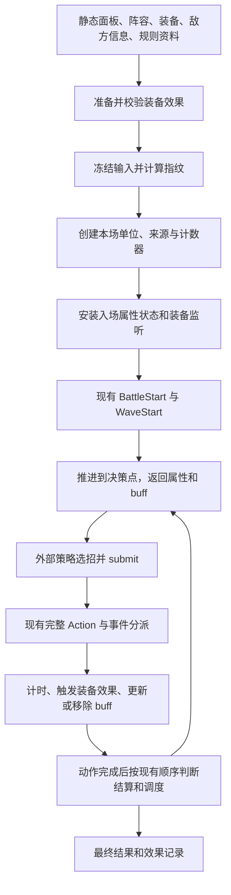

# 装备效果与 Buff 生命周期设计

本文档定义装备效果（光锥、遗器套装）向战斗模拟核心接入的后续扩展方案。当前已实现的战斗核心基础能力见[系统架构与逻辑设计](design.md)。

## 方案目标

在开战前接收调用方已完成基础面板计算的装备绑定配置，由战斗引擎负责安装装备附带的动态效果（如永久属性修饰、事件监听触发、有界持续时间状态、Buff 叠层刷新与到期清理）。选招与外部决策仍继续通过 [`BattleSession`](stepping.md) 统一进行。

## 输入与职责

[账号模块](../account/playable-configuration.md)已经计算遗器主副词条、套装无条件常驻属性、适用光锥无条件常驻属性。继续沿用这个口径：静态面板作为战斗输入，战斗安装尚未计入面板的装备效果。

| 部分 | 负责内容 |
| --- | --- |
| 账号配置与战斗输入组装 | 确定装备归属、光锥叠影、实际套装件数、试用或映射配置，生成静态面板及其基础分量 |
| 规则资料 | 提供固定版本的数值、效果 ID、来源引用和核对状态 |
| 战斗准备 | 根据装备和规则资料展开本场有效效果，检查支持范围，生成不可变战斗输入 |
| 战斗执行 | 初始化效果、响应事件、维护计数器和 buff、计算有效属性、导出状态 |

装备效果拆成稳定的效果条目。例如同一套装的无条件增伤和使用技能后的临时增伤使用两个效果 ID。前者由静态面板计算，后者交给战斗，保证每条贡献有一个计算位置。引擎无法仅凭最终面板反推出是否重复计入；这项约定通过账号与战斗组装的联合样例核对。

首批输入表达光锥和遗器套装。玩法专属装备取得明确的字段和规则后再增加类型。

拟新增 `Unit.equipment: Vec<EquipmentBinding>`，每项包含：

| 字段 | 用途 |
| --- | --- |
| `binding_id` | 本场该装备来源的稳定 ID，区分实际库存、试用与映射来源 |
| `kind` | 光锥或遗器套装的带类型数据 |
| 光锥数据 | 种类 ID、叠影、适用效果所需的明确参数 |
| 套装数据 | 套装 ID、实际生效件数，以及用于追溯的装备或模板引用 |

遗器以达到门槛的套装效果安装，一组四件套的四件遗器共同激活四件效果一次。试用和映射配置使用稳定的模板绑定 ID。调用方传入已确认的套装组成；缺少组成时返回缺失信息。

数值资料通过库参数显式传入。拟新增准备入口：

```rust
prepare_with_equipment(scenario, rules) -> Result<ValidatedScenario, PrepareError>
```

准备步骤复用现有校验，展开后保存装备、效果来源、数值与规则快照身份，场景指纹覆盖这些信息。CLI 负责读取资料文件，模拟循环使用内存中的已校验数据。批次共用不可变输入，每局单独创建计数器与状态。

新增格式按版本接入。旧版无装备输入保留现有校验和指纹口径；旧接口遇到需要装备资料的新输入时明确要求使用准备入口。未知装备、未实现效果、缺失数值、版本不匹配均在准备阶段报告，错误带单位、绑定和效果 ID。

## 规则如何编写

装备效果使用 JSON 模板定义，Rust 在准备阶段读取、校验并展开为 `EquipmentEffectDefinition`。叠影参数保留五档，按本场装备等级取值后生成固定参数定义。具体格式和能力表对照见[装备 JSON 与机制覆盖方案](equipment-json-design.md)。效果定义复用现有 `Effect`、条件和表达式，添加装备所需的事件上下文与属性读取。相同的伤害、加状态和请求动作继续调用原执行器。

一个装备可以有多条效果，每条包括初始化效果或事件监听、触发条件、有界局部计数器，以及规则来源。Rust 维护通用机制和带类型的文件结构；新装备通过组合已有规则接入，遇到新底层机制时再扩展执行器。

例如以下两个合成规则用于软件验收，具体数值和时机不代表某件真实装备：

- 入场获得暴伤提高 20% 的永久状态。
- 使用战技前，为自身添加增伤 10%、最多两层、按自身普通回合结束扣两次的状态。

这些规则只需要定义参数、事件和效果组合。真实装备逐条记录游戏版本、资料快照、条目 ID 和核对状态；资料查阅与数值修正遵循[游戏规则](../../project/game-rules.md)及仓库分工。

## 来源、实例和规则定义

当前 buff 的来源只有施加单位，新设计补充具体效果身份：

| 类型 | 保存什么、为什么需要 |
| --- | --- |
| `EquipmentBinding` | 本场装备归属与参数，连接输入配置和规则 |
| `EquipmentEffectDefinition` | 可复用的装备效果规则；运行时计数器与规则定义分开保存 |
| `EffectSource` | 单位 ID、装备绑定 ID、效果 ID；同一角色的两条装备效果各有来源 |
| `ModifierDefinition` | 属性贡献、重复施加方式、上限、计时和移除规则；技能与装备共用 |
| `ModifierInstance` | 一次实际存在的 buff，保存实例 ID、持有者、完整来源、层数、余寿命与属性数值 |

技能来源按单位和技能效果标识表达，同样进入 `EffectSource`。装备来源穿过条件、循环和嵌套监听时保持可追溯，不能在执行 `AddModifier` 时退化成当前执行者 ID。

实例 ID 在单场内单调生成；刷新同一实例保留 ID，移除后重新施加获得新 ID。效果局部计数器按完整来源隔离，buff 自身计数器按实例隔离，避免相同变量名串值。

## 唯一性、叠层与刷新

把“哪些实例能共存”和“再次施加如何更新”分别定义。唯一性的范围为同一目标上的同一 buff 组；不同目标分别维护。

| 共存方式 | 实例匹配 | 再次施加 |
| --- | --- | --- |
| 目标唯一 | 目标 + buff 组 ID | 首批支持新状态替换旧状态，旧来源与其监听一起移除 |
| 按效果来源分别存在 | 目标 + buff 组 ID + 完整 `EffectSource` | 同来源替换层数或累加层数；不同来源独立存在 |
| 每次施加独立存在 | 每次获得新实例 ID | 各自持有数值与寿命；最大实例数和满额处理方式必须有明确规则 |

buff 组 ID 表达“这些效果互相覆盖或叠加”，装备 ID 用于追溯来源，两者分别维护。跨装备共用 buff 组时，在准备阶段核对共存规则一致。

最大层数作用于一个实例；独立实例上限作用于一个目标上的该 buff 组。同来源叠层是否重置寿命使用显式的“重置”或“保留”规则。首批属性值沿用添加或刷新时求值的方式；同一实例各层共享更新后的每层数值。需要每层独立数值或寿命时，使用独立实例表达。

首批实现目标唯一和按来源共存。独立实例在有具体装备条目及满额规则后接入。最强值生效、较弱来源备用和光环恢复也需要对应规则；遇到这些条目时准备入口报告尚未支持，避免把“唯一”统一解释成新状态覆盖。

## 持续时间与移除

持续时间分为永久和按事件计数两类。永久状态没有倒计时，可以被规则指定的移除操作删除。

按事件计数需要明确四项：

| 配置 | 含义 |
| --- | --- |
| 事件 | 回合开始、回合结束、动作结束或 Cycle 结束等 |
| 计时对象 | buff 持有者或来源单位 |
| 回合种类 | 普通回合、终结技回合、额外回合的允许集合 |
| 首次扣减 | 下一个匹配事件，或跳过施加时所在的那个回合 |

给每次单位回合分配稳定 `turn_id` 和回合种类，避免插入终结技后把外层普通回合认错。追击继续作为 Action 运行，使用动作结束计数时单独配置。持续两次表示经历两次符合这些条件的事件。

首批沿用现有顺序：事件发生后先扣次数并移除到期状态，再执行该事件的监听。事件入口固定本次需要计时的实例集合；本事件监听中新增的实例从后续匹配事件开始计数。嵌套事件有各自身份，重新核对计时规则。

因此，“普通回合结束减一”和“所有单位回合结束减一”可以分别配置。Cycle 倒计时使用独立的 `CycleEnd`，不与单位 Turn 混用。

buff 定义还要注明持有者死亡后保留还是清除；永久表示寿命没有上限，死亡清理规则单独决定。首批保持旧输入既有行为，新装备条目必须明确死亡和复活后的状态规则。依赖来源持续存活的团队光环，需实现死亡、复活和入场时的成员更新后才能标为支持。

主动移除可按实例 ID、buff 组及来源定位。移除时统一清理属性贡献与绑定监听，并记录到期、主动移除、覆盖或死亡清理等原因。

## 触发与属性计算

事件处理复用现有分派入口，补充 `EventContext`：事件身份、行动实例身份、操作者、受影响目标、技能种类、回合身份、元素和命中种类。其中字段按事件种类提供，缺少必需上下文的监听在准备阶段拒绝。

这解决现有 `Hit` 的主体为攻击者的问题：装备的“造成命中”和“受到命中”分别匹配操作者与受击目标。每行动触发一次使用行动实例 ID 去重，多段命中和多目标分别由效果规则限定次数。

装备常驻监听跟随装备来源安装；限时 buff 的监听绑定具体实例，随实例移除一起停用。事件入口取得稳定的监听列表，执行前重新核对实例是否存在。首批按单位、装备绑定、效果声明顺序稳定执行；真实条目需要不同先后时，先核对再定义明确顺序。

已有 `Property` 只支持暴伤和增伤。首批为示例所需的暴击率、暴伤、通用增伤、攻击固定值/百分比、速度固定值/百分比扩展属性读取，并提供统一的 `effective_stats(unit, context)`。伤害、治疗、护盾、目标血量比例、行动轴和观测按各自需要复用统一读取，不让每个装备直接改基础面板。

百分比属性所乘的基础值与静态总值分别传入。例如：

```text
当前攻击 = 静态攻击总值 + 攻击基础值 × 战斗百分比加成 + 战斗固定加成
```

账号 `PanelStat` 已保存 `base` 与 `added`，组装时保留所需分量。只有最终攻击值的旧输入继续使用原路径；含攻击百分比 buff 的新输入缺少基础值时拒绝。无法通过最终值反推基础值。

速度 buff 影响下次等待 AV，添加或移除均保持已有剩余行动距离。已有绝对变速效果写入未叠加 buff 的当前速度层，再由统一读取合成。最大生命变化需要额外确认当前 HP 如何调整；首批不接入这类条目。防御、抗性、治疗等属性随首批实际条目逐项增加，并核对乘区与有效范围。

属性查询保持只读，动态效果通过事件显式改变状态。依赖实时属性的门槛或实时光环需要明确求值时机及循环依赖规则，首批不接受未定义的属性相互依赖。

## 在战斗流程中的位置



初始入场状态安装完毕后再触发现有开战事件，条件读取统一的入场状态。换波和有限队列补位同样通过共用入场安装函数；新单位安装完成后才参与合法操作检查。一次性初始化每个单位只执行一次，复活的重新触发行为按装备规则配置。

装备触发的即时效果参与当前事件处理；登记的追击等请求继续在完整 Action 后调度。选招与执行、有限队列补位、AV 归零后的 Turn 收尾和两种独立终局触发沿用[分步执行约定](stepping.md)。等待外部决策期间不执行装备触发、倒计时或随机采样。

## 对外读取与文件安排

在现有观测与结果中增加 buff 实例 ID、来源、组 ID、层数、余寿命与扣减条件，并提供当前有效面板。可见的装备触发计数和冷却按资料规则导出，完整内部状态与策略观测分别管理。回放记录效果触发、状态添加/刷新/移除及具体原因；关闭回放仍完整执行规则。

拟修改位置如下，实际名称随实现保持职责一致：

| 位置 | 修改内容 |
| --- | --- |
| `model/equipment.rs` | 装备绑定、规则输入及准备结果的公开类型 |
| `equipment/` | JSON 模板读取、参数选择与装备规则展开 |
| `model/unit.rs`、`model/scenario.rs` | 装备与属性基础分量输入、版本与指纹 |
| `model/events.rs` | 事件上下文、回合种类和身份 |
| `mechanics/modifiers.rs` | 完整来源、实例匹配、刷新与计时 |
| `mechanics/stats.rs` | 共用有效属性计算 |
| `engine/state.rs` | 共用单位入场安装和每局效果状态 |
| `engine/events.rs` | 计时、监听、移除及上下文传递 |
| `engine/session.rs`、`engine/operations.rs` | 回合/行动身份及观测，保持原调度职责 |
| 伤害、治疗、护盾、目标、行动轴与结果入口 | 使用共用属性与状态读取 |

## 实施顺序与验收

1. **来源与准备入口。** 装备输入、固定规则资料、完整来源、重复安装检查、错误定位与版本兼容。
2. **buff 状态。** 永久、回合开始/结束、普通/插入/额外回合过滤、唯一/按来源共存、叠层、刷新、显式移除与观测。
3. **事件与属性。** 事件双方身份、每行动触发限制、实例绑定监听、共用属性读取和速度变化。
4. **装备条目。** 根据数据仓库中已核对资料逐条接入，先完成永久状态和技能触发限时状态的代表样例。

软件验收使用独立确定结果的合成样例，至少覆盖：

- 四件套只安装一条对应门槛效果，静态贡献与战斗贡献各计一次；试用、映射与原装来源均可追溯。
- 同角色不同装备效果互不覆盖；不同角色同名 buff 按声明共存或覆盖。
- 永久状态跨多个 Cycle 保留，显式移除立即停止属性贡献及绑定监听。
- 回合开始扣次数与回合结束扣次数分别成立；普通、终结技、额外回合过滤，以及施加当回合跳过规则成立。
- 同来源叠层、最大层数、寿命重置/保留，以及新增状态在事件中的首次计时符合约定。
- 多段命中每行动触发一次；“受击触发”由受击目标装备响应。
- 速度 buff 到期保留距离，影响下一次等待；百分比攻击按基础值计算。
- 持有者死亡与复活、换波、队列补位按条目执行初始化与保留规则。
- 外部等待时重复读取不改变状态；分步调用与同步策略使用相同种子和操作得到相同结果；批次各局计数独立。
- 未支持属性、光环或独立计时规则在准备阶段报告；旧版无装备场景的既有规则回归通过。

首批真实装备清单、游戏精确版本、死亡保留、首次扣减和唯一 buff 的覆盖规则，随对应条目核对记录补齐。软件测试证明实现符合输入约定；游戏机制的确认保留单独依据。
