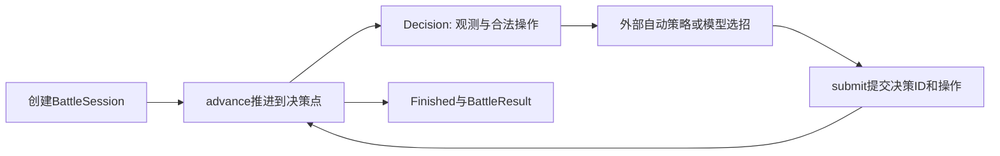

# 外部选招与分步执行

`BattleSession`把战斗推进、策略选招和操作执行分开。自动策略、模型推理和训练程序可以共用同一套规则：引擎推进到决策点并返回数据，调用方决定操作，再交给引擎执行。

## 调用流程



| 接口或类型 | 用途 |
| --- | --- |
| `BattleSession::new` | 为已校验输入创建独立状态与随机流，执行开战和首波事件。输入在会话期间保持存活。 |
| `advance` | 推进到下一个决策或结束结果。已有待回答决策时，重复返回相同数据。 |
| `Decision` | 保存本场递增的`id`、决策点`point`、当前`observation`和合法操作`legal`。 |
| `submit(id, choice)` | 验证决策ID和合法性后执行选择。旧ID、重复提交、非法操作和普通回合的空选择在修改状态前报错，当前决策仍可重试。 |
| `BattleStep` | 通过`Decision`或`Finished`两种结果表示当前停在哪里。 |
| `advance_cancellable` | 在推进边界检查取消；模型等待期间也可以取消，得到`Incomplete/Cancelled`快照。 |
| `into_result` | 消费已完成会话并取得最终结果。 |

等待外部推理期间，时间推进、技能付费、事件分派和随机采样均停在当前决策点。重复读取保持同一决策ID和相同观测。

普通Turn和额外Turn的`submit`执行一个完整Action。插入窗口的`submit`登记预选终结技请求；后续`advance`在该请求实际入Turn时检查资源并支付能量。`None`表示放弃本次插入机会。`legal`为空的插入窗口也可以直接提交`None`。

## 推理与训练读取什么

`Observation`包含当前AV、Cycle和本轮/总剩余AV、双方战技点、排序后的行动轴，以及已经入场单位的HP、护盾、能量、距离、韧性、动态值、状态和弱点。`legal`提供当前允许的单位索引和动作索引，模型据此构造合法动作掩码。

`Decision`、`Observation`和`Operation`可序列化；`Operation`也可反序列化，便于本地适配层传递操作。观测保留当前引擎已维护的信息。随机种子、随机流和未来队列未通过该观测传给策略；各机制信息是否符合玩家可见范围，仍由后续来源接入逐项核验。

训练程序可以依次记录“当前观测、合法操作、所选操作、下一观测或结果”，在研究模块计算奖励和更新模型。推理程序读取同样的观测并提交操作。双方单位的策略路由由调用方决定，已有`Automatic`和`Policy`可以继续使用。

Python绑定`sim_native`仍处于规划阶段。当前交付Rust分步接口和可运行示例，后续绑定复用该接口。输入所有权、Python对象生命周期和具体张量编码随绑定一起实现。

## 可运行示例

从仓库根目录运行：

```powershell
cargo run -p battle-core --example step_battle --locked -- core/battle/examples/duel.json 7
```

示例位于[`step_battle.rs`](../../../core/battle/examples/step_battle.rs)，核心调用如下：

```rust
let mut battle = BattleSession::new(&input, seed, true)?;
while let BattleStep::Decision(decision) = battle.advance()? {
    let (id, operation) = (decision.id, choose(decision));
    battle.submit(id, operation)?;
}
let result = battle.into_result()?;
```

`choose`由调用方实现。示例选择第一个合法操作；模型接入时替换该函数。同步入口`simulate_with_policy`也通过这套会话调用`Policy::decide`，`simulate`、CLI和批次评估继续复用它。

## 两种独立的结算触发

来源：负责人于2026-11-17在本次协作中确认，适用客户端的精确版本号待补。

1. **清场或全灭。** 当前完整Action或调度步骤结算后，满足终局淘汰条件即可返回结果。有限队列中尚未入场的敌人及后续波次按各自流程处理。
2. **最终倒计时回合结束。** Cycle表示轮次倒计时节点的回合；单位Turn在其中按行动轴推进。复活罚时可以让本轮额度归零，已经进入的单位Action和相应Turn收尾仍然完成，再处理到期的Cycle。最终Cycle结束后按AV额度耗尽结算；存在下一Cycle时装载下一轮额度。

满足其中任一结束条件即可结算。取消和行动保护仍返回未完成状态。

技能伤害与HP变化依显式效果逐项执行。软件回归可以构造命中监听伤害来检查复活和额度边界，这类输入验证引擎的执行顺序。真实角色技能、触发时机与数值需要来源资料确认。本次没有据合成的“回合开始清场”输入新增游戏规则。

## 已验证的场景

- 同一暂停点重复读取保持观测、资源和随机过程一致。
- 非法、过期、重复提交及执行失败的处理。
- 外部策略选择不同技能可改变战斗结果。
- 两场会话交错推进，结果分别与相同种子的同步调用一致。
- 四个公开示例逐决策驱动与同步运行的完整结果一致。
- 终结技登记请求与实际入Turn付费的顺序。
- 模型等待期间取消，返回未完成快照。
- 额度归零时先完成已进入的单位Turn，再发生CycleEnd；清场可独立提前结束。

测试位于`core/battle/tests/session.rs`；其余现有回归继续检查波次、资源、监听、种子、CLI和批次统计。
