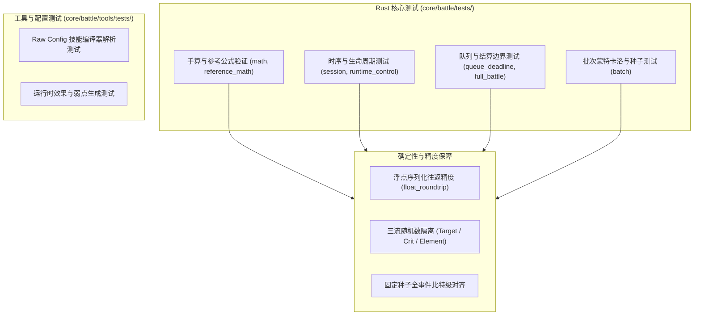

# 战斗模拟验证与测试指南

本文档阐述 `core/battle` 战斗模拟核心的自动化验证体系、测试分层、确定性保障原则以及本地回归执行方式。

---

## 1. 验证体系架构

战斗模块的正确性由多层次测试套件共同保障：



### 测试用例分布

| 测试目录 / 文件 | 覆盖范围与验证要点 |
| --- | --- |
| `tests/reference_math.rs` | 采用预设的标准参考数值，手算核对七元素、基础增伤、防御抗性、易伤等 18 个不同乘区组合的单次命中伤害计算。 |
| `tests/session.rs` | 覆盖 `BattleSession` 外部决策状态机：决策暂停点、非法 ID 提交、重复提交幂等性、终结技排队与入场扣能、取消与恢复边界。 |
| `tests/queue_deadline.rs` | 覆盖有限敌人队列与轮次耗尽边界：动作彻底完成后补位、超时快照保全、同刻 Cycle 结算次序。 |
| `tests/runtime_control.rs` | 覆盖有序效果树（`Effect`）：条件分支（`Conditional`）的短路求值、循环展开（`Repeat`）的迭代次数控制、调用帧栈（`DynamicScope`）的变量隔离与遮蔽。 |
| `tests/property_modifiers.rs` | 覆盖状态（Modifier）生命周期：叠层上限、按来源独立叠加、回合到期扣减、即时监听修改后续同 Action 命中数值。 |
| `tests/batch.rs` | 覆盖批次评估：多局试验的种子派生唯一性、胜负统计、未完成场次隔离及 95% Wilson 置信区间数学正确性。 |
| `tools/tests/` | 覆盖 Python 预处理工具链：包含配置提取、技能链降解（Lowering）、表达式 AST 转换与示例场景构建器。 |

---

## 2. 确定性与回归原则

为保证战斗模拟在离线训练、蒙特卡洛搜索与玩家应用重放之间的一致性，核心库遵循以下原则：

1. **三流随机数隔离 (Three Independent RNG Streams)**：
   - 每场战斗基于单一输入种子，通过 `rand_chacha` 派生三条完全独立的伪随机数流：**目标选择流**、**暴击判定流**、**元素选择流**。
   - 目标选择的随机扰动绝不影响暴击概率，反之亦然。这保证了在控制某一机制变量时其余随机行为保持稳定。
2. **64 位种子无损传输**：
   - 随机种子在 Rust 内部为 `u64`。
   - 在 JSON 格式中序列化为十进制字符串（如 `"18446744073709551615"`），防止外部语言或前端运行时解析为 JavaScript Number 时发生精度截断。
3. **浮点往返序列化一致性**：
   - 启用 `serde_json` 的 `float_roundtrip` 特性，保证任意已校验场景在序列化后重新反序列化读入时，其浮点数值、生成的 SHA-256 场景指纹及时间步边界保持严格一致。
4. **单局与批次对齐**：
   - 批次评估（`batch`）中第 $N$ 局的表现，必须与将该局派生种子单独传入单局模拟（`simulate`）得到的结果与事件流完全一致。

---

## 3. 本地验证执行方式

### 3.1 核心 Rust 测试与代码质量检查

在仓库根目录下运行：

```powershell
# 1. 运行工作区全部测试
cargo test -p battle-core --locked

# 2. 执行严格静态代码检查（禁止任何 Warning）
cargo clippy -p battle-core --all-targets --locked -- -D warnings

# 3. 检查代码格式
cargo fmt --all -- --check
```

### 3.2 Python 配置与工具测试

在 `core/battle/` 目录下运行：

```powershell
python -m unittest discover -s tools/tests -t . -p "test_*.py"
```

### 3.3 示例场景对照与冒烟测试

使用内建的四个基础场景运行单局与批次模拟，确认无 Panic 与非正常退出：

```powershell
cargo run -p battle-core --release --locked -- simulate core/battle/examples/duel.json 42
cargo run -p battle-core --release --locked -- simulate core/battle/examples/team-waves.json 42
cargo run -p battle-core --release --locked -- simulate core/battle/examples/revival-budget.json 42
cargo run -p battle-core --release --locked -- simulate core/battle/examples/anaxa-s2-full-battle.json 42

cargo run -p battle-core --release --locked -- batch core/battle/examples/duel.json 100 42
```
