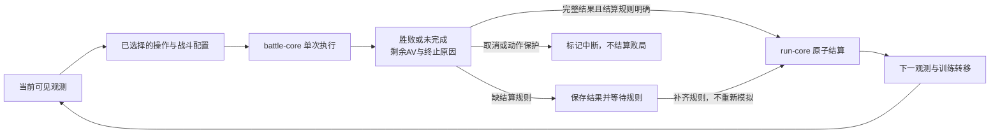

# 单次战斗与整局推进

本分支提供 Rust `run-core` 框架候选，复用 `core/battle` 执行一场战斗，保存结果，再按显式规则结算生命、金币、晶矿和节点进度。先用合成示例确认接口与状态变化，真实节点规则按证据逐项接入。本轮提交后等待团队对框架的明确反馈。

## 一次结果怎样推进对局

训练中每条环境轨迹独立推进；某节点输了仍保存这次结果，并根据实际结算后的生命判断能否继续。同一节点反复抽到胜利、以平均胜率替换实际胜败，都会改变训练经历，因此不属于 `step` 的行为。同场批次比较由现有 `battle::batch` 独立承担。

玩家应用中的模拟轨迹与实际游戏记录分开。候选试算不能直接改玩家真实资源；应用仍依据玩家确认的操作和结果更新实际记录。

## 模块契约

| 所有者 | 职责与接口 |
| --- | --- |
| `battle-core` | 校验显式场景，执行动作和随机过程，返回 `BattleResult`、事件和终止原因 |
| `run-core` | 维护整局资源与当前节点，保存一次采样结果，执行适用结算规则，防止重复结算，返回下一观测和训练记录 |
| 账号与配置转换 | 提供有效配置和规则版本；既有原始账号生成保留，完整配置转换仍待实现 |
| 策略与训练调用方 | 从可见观测选择操作，保留实际失败，按整局组织经验；训练器和多环境并行执行器后续接入 |
| Tauri + TypeScript | 调用同一 Rust 核心，展示单场表现、结算和建议；窗口与命令适配尚未实现 |
| 离线评估 | 使用独立副本和随机源比较候选，输出统计；不消费当前对局的结果或修改其账本 |

`RunEnv` 持有权威状态。当前合法动作仅为 `Ready` 时的 `FightCurrentNode`；商店和战斗准备操作后续扩展。调用方通过 `observe` 获取当前可见信息，通过 `sample` 取得并保存一次战斗结果，通过 `settle` 结算该结果；`step` 组合这两步。结算规则缺失时，仍能取得本次战斗的结果并停在待结算状态。每次调用关联对局、节点、请求、状态修订、场景指纹、账号配置和规则来源。

成功重点报告剩余 AV；失败报告 `AlliesDefeated` 或 `AvBudgetExhausted` 等可核对的终止原因。它们说明模拟何时停止，不能直接解释为“阵容错误”或“伤害不足”的因果判断。平局单列；`Cancelled` 和 `ActionLimit` 属于未完成，不能冒充败局结算。

当前 `basic_v1` 的 AV 账本包含自然流逝和复活罚时。展示剩余值截在零，同时保存有符号预算差及超支信息。完整动作内的最终击杀可能与罚时超支同时发生，仍保留引擎既有胜负优先级。本框架没有借输出诊断改写 Cycle 或复活规则。

## 资源、缺项与训练记录

当前生命与生命上限分别记录，金币和晶矿分别结算。规则输入声明版本、标识和来源，通过节点配置或结算请求绑定当前节点，并对实际胜／败／平结果给出明确规则；首版只接受 `synthetic_explicit_v1`。真实规则尚缺时不填零，也不从角色剩余 HP 推算整局扣血。

结算完成前不提前更改资源或节点。无效资源变化、过期修订和身份冲突应明确返回错误；重复提交不能再次扣血、发钱或产生第二条已结算训练转移。补齐缺失规则使用已保存的同一战斗结果。

经验保留操作前观测、操作身份、真实单场结果、结算后的观测及版本。完整败局不丢弃；待结算记录的后继状态与未定义奖励保持未知。随机种子、完整事件和场景引用用于环境回放，不进入策略可见观测。仅有轨迹记录不表示训练算法或奖励设计已经完成。

## 使用与验证

构建、示例及公开 Rust 接口见 [run-core 使用说明](../../../core/run/README.md)。本模块独立维护 Cargo 配置、锁文件与工具链；不需要根 Cargo workspace 或 Python 绑定才能运行合成端到端示例。

首批验证覆盖：真实引擎驱动的败局继续与后续胜利、HP 归零、缺规则后补结算、重复请求、状态版本、资源越界原子拒绝、取消与动作保护、环境隔离、种子回放，以及胜利时的 AV 超支诊断。实际结果随本轮 PR 的验证回执报告；真实游戏规则验证单独记录。

## 框架评审与继续条件

请项目负责人及对应模块维护者对下列各项给出 **认可／有条件认可／不认可**，并说明需要改动的字段、行为或证据。未回复不视为认可，代码助手的独立检查也不代替团队架构认可。

| 待评价事项 | 希望确认的具体问题 |
| --- | --- |
| 单次采样主线 | 每个实际选择的遭遇只执行一次，成功看剩余 AV、失败保留原因，是否准确落实产品与训练用途？ |
| 模块职责 | battle 计算战斗、run 结算与推进、账号侧提供配置、训练侧消费轨迹的边界是否可接入？ |
| 结算和状态 | 保存待结算结果、原子资源变化、去重、修订冲突及节点失败继续的约定是否合适？ |
| 首版规则与诊断 | 合成规则的边界、AV 分账和失败诊断是否清楚；第一个真实节点由谁提供哪些证据？ |
| 训练单位 | 多条独立整局、失败经历不丢弃、未完成单列、奖励待定义的接口是否满足训练需求？ |
| 技术接入 | 保留模块自持 Cargo，之后再验证 Python 绑定和 Tauri 命令适配的顺序是否接受？ |
| 后续范围 | 哪些条件必须先满足，才能开始真实节点、完整运营和训练接入？ |

总体阶段和可认领任务见[实施计划](../../project/roadmap.md)。本轮完成框架基础及 PR 交付后停止扩展，收到明确反馈并处理约定后再进入下一阶段。
